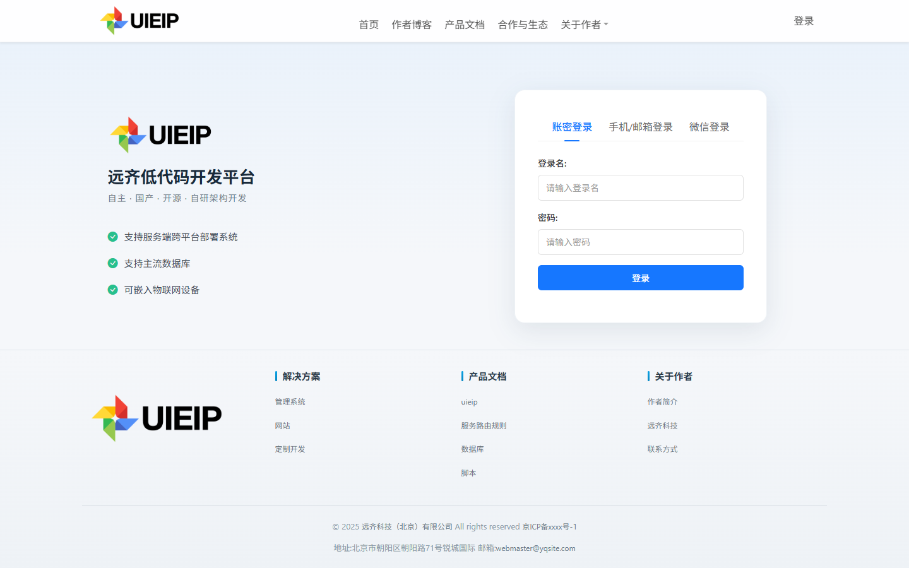
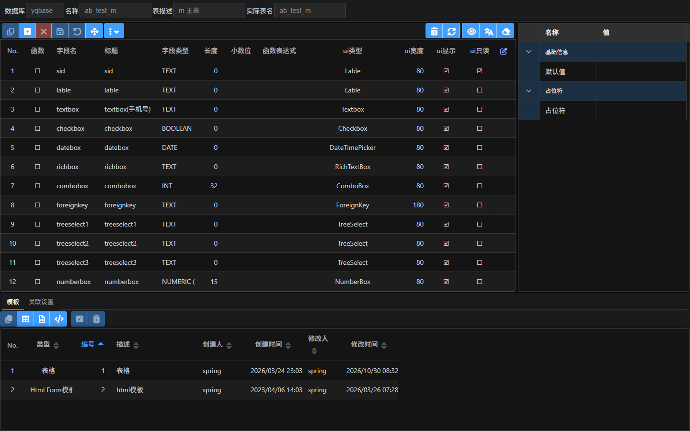
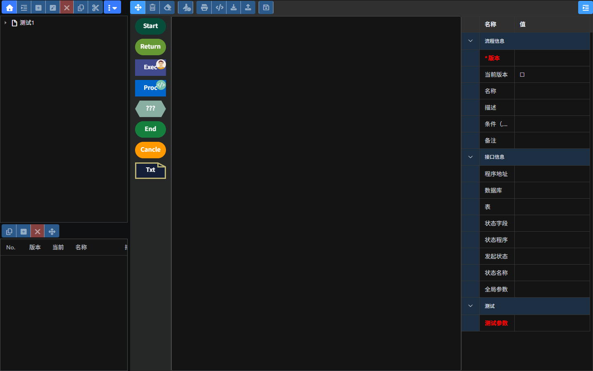
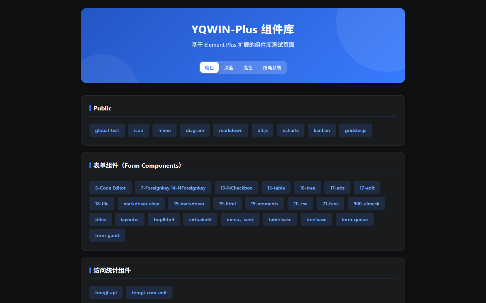

# UIEIP · 远齐低代码开发平台

> **一句话：一个 Go 单文件，把「数据建模 + 表单 + 权限 + 流程 + 门户 + AI 知识库」全装进去——不用再拼四五个中间件，才能凑出一个能用的企业后台。**

[English](readme-en.md) | 中文

[](LICENSE)
[](web/document/note.md)
[](https://go.dev/)
[](https://gitee.com/uieip/yuanqi-open)

**国内访问**：GitHub 慢的话请用 Gitee 镜像 <https://gitee.com/uieip/yuanqi-open>（与 GitHub 同步，项目简介与标签一致）。

**文档站**：<https://uieip.github.io/yuanqi-open/>　·　**许可证**：MIT　·　**版本**：v1.0（2026-10-06）

---

## 效果图

> 截图取自本仓库发布包的真实运行界面（Windows + SQLite，默认深色后台）。

| 登录页 | 数据建模（字段与属性配置） |
| --- | --- |
|  |  |

| 流程设计器 | YQWIN-Plus 组件库 |
| --- | --- |
|  |  |

---

## 快速开始（3 行，复制即跑）

Windows 10/11 或 Windows Server（x64），**不用装 Go、Node.js、数据库、Web 服务器**：

```powershell
git clone https://github.com/uieip/yuanqi-open.git D:\Spring\yuanqi-open
cd D:\Spring\yuanqi-open; .\uieip-windows.exe
start http://127.0.0.1:8011/adp/    # 账号 spring / 密码 uieip.123
```

> ⚠️ **必须是 `D:\Spring\yuanqi-open`**：随包 `config.json` 使用绝对路径。换目录请先改 `webpath`、`db.yqbase.connStr` 等，见[快速开始文档](docs/getting-started.md#换目录)。
>
> 也可以直接下载 Release 压缩包解压后双击 `uieip-windows.exe`。

| 入口 | 地址 |
| --- | --- |
| 管理后台 | http://127.0.0.1:8011/adp/ |
| 站点首页 | http://127.0.0.1:8011/ |
| 组件库示例 | http://127.0.0.1:8011/yqvue/ |

---

## 为什么要用它

企业后台里，业务代码常常只占 20%，剩下 80% 是建模、表单、权限、流程、门户、文件、登录这些“公共设施”。UIEIP 把这些做成平台，业务侧只写**模型 + 页面 + 服务端 JavaScript**。

| 你原本要做的 | 在 UIEIP 里 |
| --- | --- |
| 设计表结构、写建表 SQL、写 CRUD 接口 | 可视化建模，自动生成表与通用增删改查接口 |
| 手写表单校验、联动、外键下拉 | 20+ 内置字段组件，模板或拖拽搭建 |
| 自己拼 RBAC、数据范围、按钮权限 | 组织/部门/岗位/人员/角色/菜单/操作标识多层权限 |
| 接入或自研审批流 | 可视化流程设计器 + 会签/或签/比例通过/退回/代审 |
| 对接 OAuth2 / OIDC / CAS / LDAP | 内置统一认证中心与兼容协议 |
| 另外搭官网和知识库 | 内置门户 CMS 与 AI 知识库（DeepSeek / Ollama + Milvus） |

## 核心能力

| 能力 | 说明 |
| --- | --- |
| 数据引擎（建模） | 实体、字段、枚举、外键、关系图建模，自动生成表与通用接口；支持树形、排序、视图、表内文件 |
| 表单引擎 | 20+ 字段/复合组件（文本、下拉、外键、表格、树、属性、文件、HTML、Markdown、CSV、函数等） |
| 权限引擎 | 组织、部门、岗位、人员、角色、菜单、操作标识，控制 UI 入口、数据范围与业务操作 |
| 流程引擎 | 开始 / 退回 / 执行 / 判断 / 程序 / 结束 / 取消 / 注释节点；会签、或签、比例通过、代审、待办已办 |
| 单点登录 | OAuth2、OIDC、CAS 2.0、SAML2、LDAP、远齐 SSO 兼容协议、微信登录 |
| 门户 / CMS | 站点、栏目、导航、文章、模板管理，访问/点赞/收藏/评论统计 |
| 知识库与 AI | 接入 DeepSeek、Ollama 等大模型，Milvus 向量库，火山引擎/Ollama Embedding，知识库问答结合业务数据 |
| 脚本语言 | 服务端 JavaScript（ES5.1），内置 request / response / http / data / session / cache / resource 等对象 |
| 文件服务 | 数据库存储与本地文件柜，图片缩放、裁剪、水印、分片上传、文件指纹 |
| 多语言 | 内置翻译管理（`sys_trans`），支持中英文等语言包扩展 |
| 运维管理 | 缓存、系统监控、统计、DNS、Nginx、NSQ、参数等管理能力 |
| 组件库 | YQWIN-Plus：页面框架、表单、数据表格、树、弹窗、图表（ECharts/D3/GoJS）、看板、甘特图 |

## 技术架构

```text
┌──────────────────────────────────────────────────────────┐
│                       浏览器 / 移动端                      │
│   YQWIN-Plus（Vue3 + TypeScript + Element Plus）/ HTML    │
└───────────────────────────┬──────────────────────────────┘
                            │ HTTP / JSON / 文件请求
┌───────────────────────────▼──────────────────────────────┐
│                 uieip 服务（Go 单文件可执行）               │
│  ┌────────────┐ ┌────────────┐ ┌────────────┐ ┌─────────┐ │
│  │ 路由/静态   │ │ 模板与脚本  │ │ 数据引擎    │ │ 权限/SSO│ │
│  │ 服务       │ │ 引擎(ES5.1)│ │ 通用接口    │ │ 引擎    │ │
│  └────────────┘ └────────────┘ └────────────┘ └─────────┘ │
│  ┌────────────┐ ┌────────────┐ ┌────────────┐ ┌─────────┐ │
│  │ 文件服务    │ │ 流程引擎    │ │ 缓存/会话   │ │ 日志/监控│ │
│  └────────────┘ └────────────┘ └────────────┘ └─────────┘ │
└───────────┬───────────────────────────────┬──────────────┘
            │                               │
   ┌─────────────────────┐              ┌────────────────┐
   │ SQLite（本包）       │              │ 本地文件柜      │
   │ data/yqbase.sqlite  │              │ files/          │
   └─────────────────────┘              └────────────────┘
```

- 服务端：Golang，单文件发布，无外部运行时依赖
- 脚本：JavaScript（ECMAScript 5.1），页面内 `<script runat="server">` 直接执行
- 前端：YQWIN-Plus（Vue 3 + TypeScript + Element Plus）
- 数据库：本包为 SQLite；正式版支持 PostgreSQL、KingbaseES 等
- 缓存/会话：内存（默认）或 Redis；消息队列：NSQ（可选）
- 反向代理：Nginx（可选，生产推荐）；向量库：Milvus（AI 知识库可选）

细节见[架构文档](docs/architecture.md)。

## 目录结构

```text
yuanqi-open/
├─ uieip-windows.exe      # Windows x64 服务主程序（单文件）
├─ config.json            # 主配置（端口、站点、数据库、日志、AI、SSO）
├─ yqdns.json             # 内置 DNS 服务配置
├─ data/yqbase.sqlite     # 系统数据库（模型、菜单、用户、权限、流程、CMS）
├─ files/                 # 文件柜：元数据 + 按年月归档的文件
└─ web/                   # 站点根目录
   ├─ adp/                # 管理后台
   ├─ api/                # API 接口（请求 .json，程序为同名 .html）
   ├─ cms/                # 门户模板与页面
   ├─ login/ account/     # 登录、个人中心
   ├─ yqvue/              # YQWIN-Plus 组件库与示例
   ├─ svrfunc/            # 服务端功能程序
   └─ document/           # 产品与开发文档（Markdown）
```

## 开源版与正式版

| 对比项 | 开源免费版（本发布包） | 正式版 |
| --- | --- | --- |
| 操作系统 | Windows x64 | Windows / Linux / macOS 等 |
| 数据库 | SQLite | SQLite、PostgreSQL、KingbaseES，持续适配 MySQL、openGauss、GaussDB、OceanBase、TiDB |
| 部署 | 单文件、解压即用 | 服务化、容器化 |
| 场景 | 学习体验、原型验证、中小企业轻量应用 | 生产环境、企业级应用、国产化环境 |
| 支持 | 社区 | 按授权提供 |

> 本发布包为免费开源运行包；正式版的多数据库、跨平台与增强能力以实际发布/授权为准。迁移路径见[迁移与对比](docs/migration.md)。

## 文档

- 在线文档站（MkDocs）：<https://uieip.github.io/yuanqi-open/>
- 本地构建文档站：

  ```powershell
  pip install -r requirements-docs.txt
  mkdocs serve    # http://127.0.0.1:8000
  ```

- 推送 `docs/` 改动后，GitHub Actions 自动构建并发布到 `gh-pages`，Gitee Pages / Vercel 可直接使用（见[部署与运维](docs/deploy.md)）
- 场景教程：[审批流程](docs/scenarios/approval-workflow.md)、[客户管理应用](docs/scenarios/customer-app.md)、[知识库问答](docs/scenarios/knowledge-base-qa.md)
- 发布包内详细文档位于 `web/document/`：服务端、WEB 框架、单点登录、脚本语言、数据库、工作流、日志管理等
- 更新记录：[web/document/note.md](web/document/note.md)

## 标签

`Go` `大模型` `Agent` `RAG` `LLM` `ai框架` `低代码` `低代码平台` `工作流引擎` `企业应用`

## 参与共建

欢迎通过 Issue、文档修订、模板与组件贡献参与共建。提问时请附上：操作系统版本、`config.json` 中脱敏后的相关配置、控制台日志。

## 许可证

本项目以 **MIT License** 发布，可免费用于商业项目。完整条款见 [LICENSE](LICENSE)。

> 平台内使用的第三方组件（Vue、Element Plus、ECharts、D3.js、GoJS、TinyMCE、Marked 等）遵循各自许可证。其中 GoJS、TinyMCE 商业版等需要商业授权的组件，**由使用者自行向权利人申请并购买授权**，本项目不代为申请，也不承担相关费用与责任。

## 免责声明

1. **软件按“现状”提供。** 不对完整性、准确性、可靠性、适用性或无中断运行作任何明示或默示担保；因使用或无法使用本软件产生的直接或间接损失，作者及贡献者不承担赔偿责任。

2. **第三方组件需自行申请授权。** Vue、Element Plus、ECharts、D3.js、GoJS、TinyMCE、Marked、jQuery、Bootstrap、Ace、Sortable、vuedraggable 等版权归各自作者或公司所有，遵循各自许可证；需要商业授权的组件由使用者自行申请、购买。

3. **第三方服务需自行开通。** 微信登录、短信、邮件、DeepSeek/Ollama 等大模型、Embedding、Milvus、对象存储等，均需自行注册、申请 Key、完成认证并承担费用与合规责任。`config.json` 中的示例密钥仅用于本地演示，不得用于生产。

4. **数据与安全责任。** 使用者自行负责数据备份、账号权限、网络安全、等级保护与内容合法性审查；因配置不当、密钥泄露、误删除、数据丢失、业务中断、网络攻击等造成的损失，本项目不承担责任。

5. **二次开发与再分发。** 修改、二次开发或再分发时，应确保不侵犯第三方知识产权，保留必要的版权与许可声明，并独立承担法律责任。

6. **使用即视为同意。** 下载、安装、部署或以其他方式使用本项目，即表示已阅读、理解并同意本声明；如不同意，请停止使用并删除相关文件。

> 本声明不构成法律意见。涉及商业授权、数据合规等事项，请咨询专业法律顾问。

---

**默认登录**：`http://127.0.0.1:8011/`　账号 `spring`　密码 `uieip.123`（首次部署后请立即修改）
