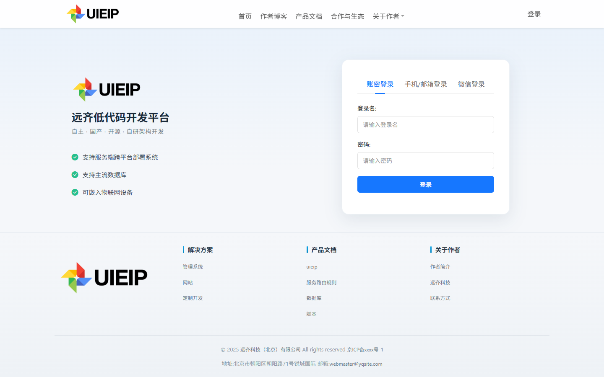
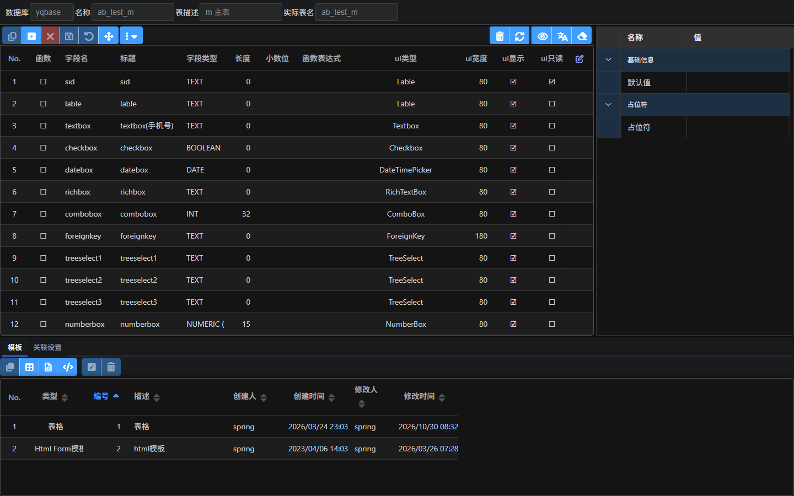
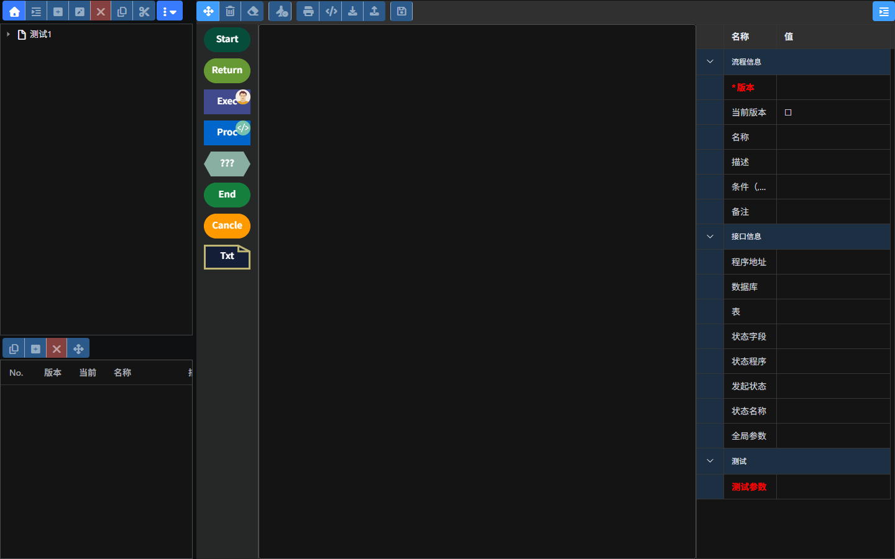
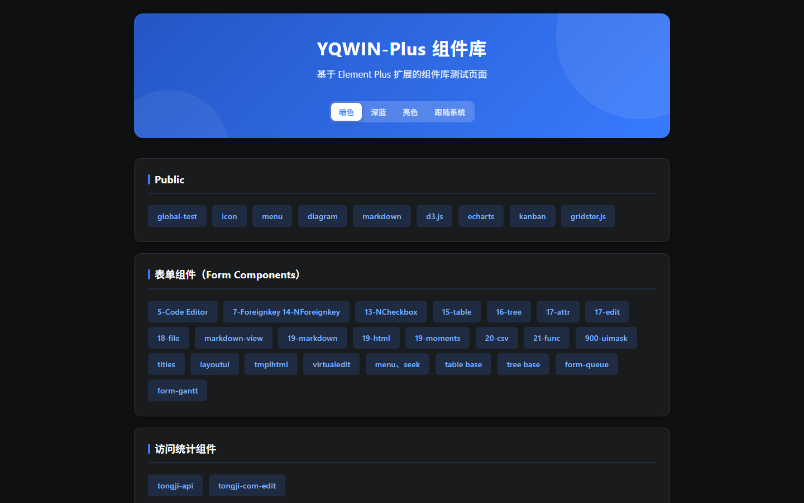

# 远齐低代码开发平台（UIEIP）

> 一个 Go 单文件，把「数据建模 + 表单 + 权限 + 流程 + 门户 + AI 知识库」都装进一个服务里。
> 不用再拼 Nginx、脚手架、权限框架、流程引擎四五个中间件，才能搭出一个能用的企业后台。

- 当前版本：**v1.0**（2026-10-06 定版）
- 开源许可证：**MIT**
- 本发布包：**Windows x64 + SQLite**，解压即用，无需安装 Go / Node.js / 数据库 / Web 服务器
- 国内镜像：<https://gitee.com/uieip/yuanqi-open>　|　GitHub：<https://github.com/uieip/yuanqi-open>

## 它解决什么问题

企业后台项目里，业务代码往往只占 20%，剩下 80% 是建模、表单、权限、流程、门户、文件、登录这些“公共设施”。UIEIP 把这些能力做成平台，业务侧只写**模型 + 页面 + 服务端 JavaScript**：

| 你原本要做的事 | 在 UIEIP 里 |
| --- | --- |
| 设计表结构、写建表 SQL、写 CRUD 接口 | 可视化建模，自动生成表与通用增删改查接口 |
| 手写表单校验、联动、下拉外键 | 20+ 内置字段组件，模板或拖拽搭建 |
| 自己拼 RBAC、数据范围、按钮权限 | 组织/部门/岗位/人员/角色/菜单/操作标识多层权限 |
| 接入或自研审批流 | 可视化流程设计器 + 会签/或签/比例通过/退回/代审 |
| 对接 OAuth2 / OIDC / CAS / LDAP | 内置统一认证中心与兼容协议 |
| 另外搭一套官网 / 知识库 | 内置门户 CMS 与 AI 知识库（DeepSeek / Ollama + Milvus） |

## 效果图

| 登录页 | 数据建模（字段与属性） |
| --- | --- |
|  |  |

| 流程设计器 | YQWIN-Plus 组件库 |
| --- | --- |
|  |  |

## 3 行跑起来

> Windows 10/11 或 Windows Server（x64），无需安装任何运行时。

```powershell
git clone https://github.com/uieip/yuanqi-open.git D:\Spring\yuanqi-open
cd D:\Spring\yuanqi-open; .\uieip-windows.exe
start http://127.0.0.1:8011/adp/    # 账号 spring / 密码 uieip.123
```

> **注意目录**：随包 `config.json` 使用绝对路径（默认 `D:\Spring\yuanqi-open`）。换目录后需同步修改 `webpath`、`db.yqbase.connStr` 等，详见[快速开始](getting-started.md)。

## 文档导航

- [快速开始](getting-started.md)：运行环境、启动、登录、配置项、换目录、改端口
- [技术架构](architecture.md)：分层结构、请求生命周期、路由与模板引擎、扩展点
- 场景教程
    - [审批流程](scenarios/approval-workflow.md)
    - [客户管理应用](scenarios/customer-app.md)
    - [知识库问答](scenarios/knowledge-base-qa.md)
- [迁移与对比](migration.md)：与传统开发/其他低代码对比，开源版 → 正式版迁移
- [部署与运维](deploy.md)：Windows 服务、Nginx、HTTPS、日志、备份
- [常见问题](faq.md)

更多细节（服务端、WEB 框架、单点登录、脚本语言、数据库）见发布包内 `web/document/` 目录，运行后也可直接访问产品自带的文档页。
