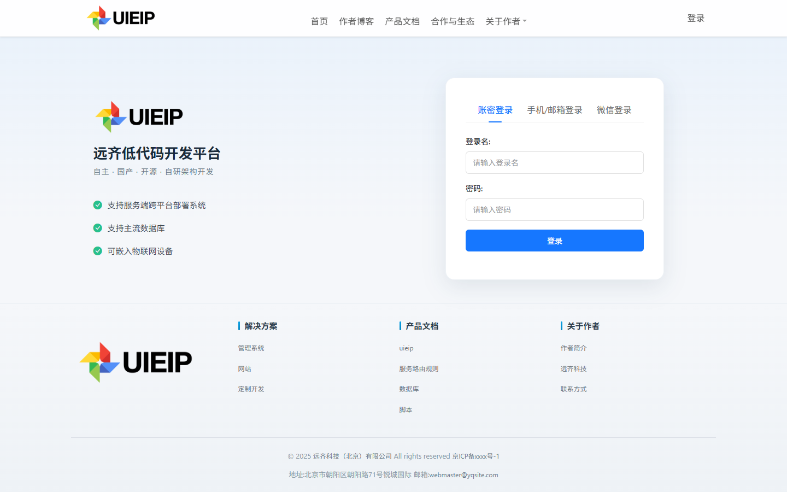
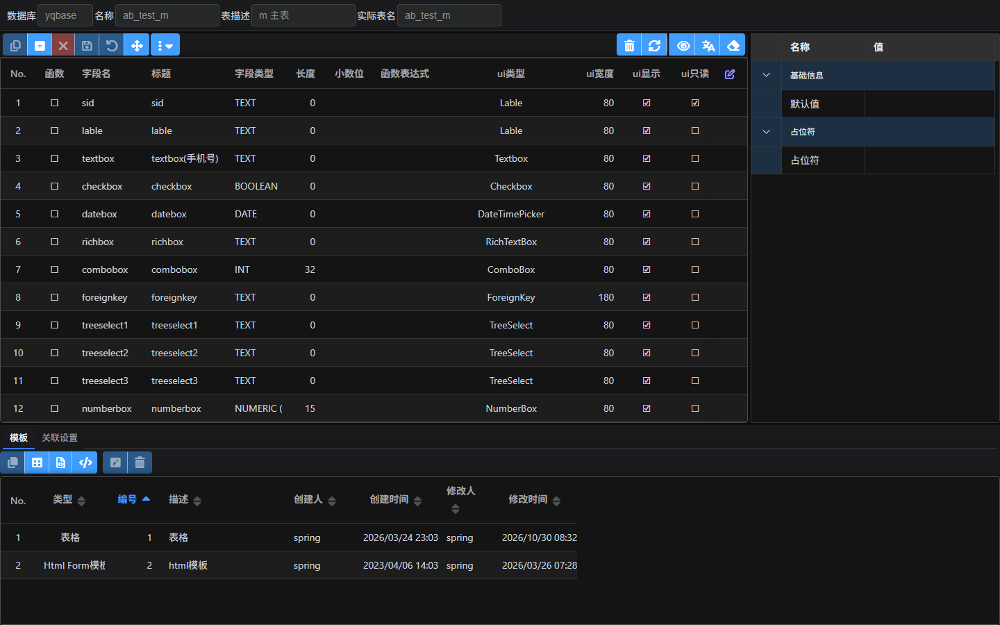
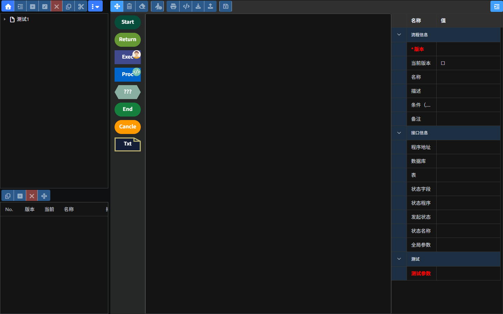
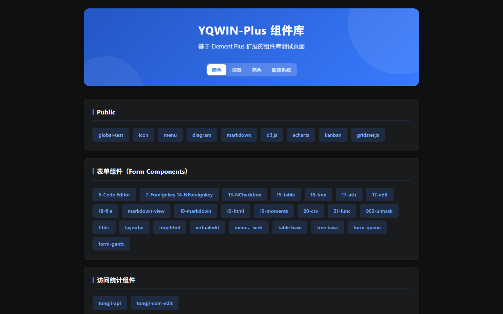

# UIEIP · Yuanqi Low-Code Development Platform

> **In one sentence: a single Go binary that ships data modeling, forms, permissions, workflow, portal, and an AI knowledge base — so you no longer stitch together four or five middleware pieces just to get an enterprise back office running.**

English | [中文](readme.md)

[](LICENSE)
[](web/document/note.md)
[](https://go.dev/)
[](https://gitee.com/uieip/yuanqi-open)

**China mirror**: if GitHub is slow, use Gitee <https://gitee.com/uieip/yuanqi-open> (kept in sync with GitHub).

**Docs site**: <https://uieip.github.io/yuanqi-open/>　·　**License**: MIT　·　**Version**: v1.0 (2026-10-06)

---

## Screenshots

> Captured from the release package running locally (Windows + SQLite; the admin console uses a dark theme by default).

| Login | Data modeling (fields and properties) |
| --- | --- |
|  |  |

| Workflow designer | YQWIN-Plus component library |
| --- | --- |
|  |  |

---

## Quick start (3 lines, copy and run)

Windows 10/11 or Windows Server (x64). **No Go, Node.js, database, or web server required.**

```powershell
git clone https://github.com/uieip/yuanqi-open.git D:\Spring\yuanqi-open
cd D:\Spring\yuanqi-open; .\uieip-windows.exe
start http://127.0.0.1:8011/adp/    # user: spring / password: uieip.123
```

> ⚠️ **It must be `D:\Spring\yuanqi-open`**: the bundled `config.json` uses absolute paths. If you extract elsewhere, update `webpath`, `db.yqbase.connStr`, and the rest first — see [Getting started](docs/getting-started.md).
>
> You can also download the Release archive, extract it, and double-click `uieip-windows.exe`.

| Entry | URL |
| --- | --- |
| Admin console | http://127.0.0.1:8011/adp/ |
| Site home | http://127.0.0.1:8011/ |
| Component library | http://127.0.0.1:8011/yqvue/ |

---

## Why UIEIP

In a typical enterprise back office, business logic is only ~20% of the code. The other 80% is modeling, forms, permissions, workflow, portal, files, and login. UIEIP turns that 80% into a platform; you write **models + pages + server-side JavaScript**.

| What you used to build | What you do in UIEIP |
| --- | --- |
| Table design, DDL, CRUD APIs | Visual modeling; tables and generic CRUD APIs are generated |
| Form validation, linkage, foreign-key selects | 20+ built-in field components; template or drag-and-drop pages |
| RBAC, data scope, button permissions | Layered permissions over org, department, position, user, role, menu |
| Build or buy an approval engine | Visual designer with countersign, any-approve, percentage approve, return, delegation |
| Integrate OAuth2 / OIDC / CAS / LDAP | Built-in authentication center and compatible protocols |
| A separate website and knowledge base | Built-in portal CMS and AI knowledge base (DeepSeek / Ollama + Milvus) |

## Core capabilities

| Capability | Description |
| --- | --- |
| Data engine | Entities, fields, enums, foreign keys, ER diagrams; auto-generated tables and APIs; tree, sort, view, and in-table file models |
| Form engine | 20+ field/composite components (text, select, foreign key, grid, tree, properties, file, HTML, Markdown, CSV, function) |
| Permission engine | Organizations, departments, positions, users, roles, menus, operation marks; controls UI entries, data scope, and operations |
| Workflow engine | Start / Return / Exec / Judge / Proc / End / Cancel / Comment nodes; countersign, any-approve, percentage approval, delegation, To-Do / Done |
| Single sign-on | OAuth2, OIDC, CAS 2.0, SAML2, LDAP, Yuanqi SSO compatible protocol, WeChat login |
| Portal / CMS | Sites, categories, navigation, articles, templates, with view/like/favorite/comment statistics |
| Knowledge base and AI | DeepSeek, Ollama and other LLMs; Milvus vector database; Volcengine/Ollama embeddings; KB Q&A combined with business data |
| Scripting | Server-side JavaScript (ES5.1) with `request`, `response`, `http`, `data`, `session`, `cache`, `resource` |
| File service | Database storage or local file cabinet; image resize, crop, watermark, chunked upload, fingerprint |
| Multi-language | Built-in translation management (`sys_trans`) with extensible language packs |
| Operations | Cache, monitoring, statistics, DNS, Nginx, NSQ, parameters |
| Component library | YQWIN-Plus: page framework, forms, grids, trees, dialogs, charts (ECharts/D3/GoJS), Kanban, Gantt |

## Architecture

```text
┌──────────────────────────────────────────────────────────┐
│                      Browser / Mobile                    │
│   YQWIN-Plus (Vue 3 + TypeScript + Element Plus) / HTML  │
└───────────────────────────┬──────────────────────────────┘
                            │ HTTP / JSON / File requests
┌───────────────────────────▼──────────────────────────────┐
│              uieip service (single Go binary)            │
│  ┌────────────┐ ┌────────────┐ ┌────────────┐ ┌─────────┐ │
│  │ Routing /  │ │ Template & │ │ Data       │ │ Auth /  │ │
│  │ Static     │ │ Script     │ │ Engine     │ │ SSO     │ │
│  └────────────┘ └────────────┘ └────────────┘ └─────────┘ │
│  ┌────────────┐ ┌────────────┐ ┌────────────┐ ┌─────────┐ │
│  │ File       │ │ Workflow   │ │ Cache /    │ │ Logging │ │
│  │ Service    │ │ Engine     │ │ Session    │ │ Monitor │ │
│  └────────────┘ └────────────┘ └────────────┘ └─────────┘ │
└───────────┬───────────────────────────────┬──────────────┘
            │                               │
   ┌─────────────────────┐              ┌────────────────┐
   │ SQLite (this pack)  │              │ Local file     │
   │ data/yqbase.sqlite  │              │ cabinet files/ │
   └─────────────────────┘              └────────────────┘
```

- Server: Golang, single binary, no external runtime dependencies
- Scripting: JavaScript (ECMAScript 5.1); `<script runat="server">` executes directly in pages
- Front end: YQWIN-Plus (Vue 3 + TypeScript + Element Plus)
- Database: SQLite in this pack; the official edition supports PostgreSQL, KingbaseES, and more
- Cache/session: in-memory (default) or Redis; message queue: NSQ (optional)
- Reverse proxy: Nginx (optional, recommended in production); vector DB: Milvus (optional)

See [Architecture](docs/architecture.md) for details.

## Directory layout

```text
yuanqi-open/
├─ uieip-windows.exe      # Windows x64 service binary (single file)
├─ config.json            # Main config (port, site, database, logs, AI, SSO)
├─ yqdns.json             # Built-in DNS service config
├─ data/yqbase.sqlite     # System database (models, menus, users, permissions, workflows, CMS)
├─ files/                 # File cabinet: metadata + files archived by year/month
└─ web/                   # Site root
   ├─ adp/                # Admin console
   ├─ api/                # APIs (request .json, program is the same-named .html)
   ├─ cms/                # Portal templates and pages
   ├─ login/ account/     # Login and account center
   ├─ yqvue/              # YQWIN-Plus components and examples
   ├─ svrfunc/            # Server-side function programs
   └─ document/           # Product and development docs (Markdown)
```

## Feature entry points

| Feature | Path |
| --- | --- |
| Admin console | `/adp/` |
| Data management / field models | `/adp/data.html`, `/adp/fields.html` |
| Menus / permissions | `/adp/menu.html`, `/adp/roles.html` |
| Workflow designer | `/adp/wfedit.html` |
| My workflows / To-Do / Done | `/adp/wf_my.html`, `/adp/wf_todo.html`, `/adp/wf_comp.html` |
| Departments / positions / users | `/adp/hr_org.html`, `/adp/hr_post.html`, `/adp/hr_user.html` |
| Portal / files / parameters | `/adp/cms.html`, `/adp/file.html`, `/adp/param.html` |
| Knowledge base / AI chat | `/adp/bikbs.html`, `/adp/ai-chat.html` |
| Service management | `/adp/svradmin/` (cache, monitoring, statistics, DNS, Nginx, NSQ) |
| Components / script tests / API example | `/yqvue/`, `/jsvm/`, `/api/hello.json` |

## Open-source vs official edition

| Item | Free open-source edition (this release) | Official edition |
| --- | --- | --- |
| OS | Windows x64 | Windows / Linux / macOS |
| Database | SQLite | SQLite, PostgreSQL, KingbaseES; MySQL, openGauss, GaussDB, OceanBase, TiDB being adapted |
| Deployment | Single binary, ready after extraction | Service-based, containerized |
| Use cases | Learning, prototyping, lightweight SMB applications | Production, enterprise, domestic/localized environments |
| Support | Community | Provided under license |

> This release is a free open-source runtime package. Multi-database, cross-platform, and enhanced capabilities are subject to the official release and license terms. See [Migration and comparison](docs/migration.md).

## Documentation

- Online docs (MkDocs): <https://uieip.github.io/yuanqi-open/>
- Build the docs locally:

  ```powershell
  pip install -r requirements-docs.txt
  mkdocs serve    # http://127.0.0.1:8000
  ```

- Pushing changes under `docs/` triggers GitHub Actions to build and publish to `gh-pages`, which can be served directly by Gitee Pages / Vercel (see [Deployment](docs/deploy.md))
- Scenario tutorials: [Approval workflow](docs/scenarios/approval-workflow.md), [Customer management app](docs/scenarios/customer-app.md), [Knowledge base Q&A](docs/scenarios/knowledge-base-qa.md)
- Detailed documentation ships inside the package under `web/document/` (server, web framework, SSO, scripting, database, workflow, logging)
- Changelog: [web/document/note.md](web/document/note.md)

## Topics

`Go` `LLM` `AI Agent` `RAG` `Large Language Model` `AI Framework` `Low-Code` `Low-Code Platform` `Workflow Engine` `Enterprise Application`

## Contributing

Issues, documentation fixes, templates, and components are all welcome. When reporting a problem, include your OS version, the relevant (redacted) parts of `config.json`, and console logs.

## License

Released under the **MIT License** — free for commercial use. Full text: [LICENSE](LICENSE).

> Third-party components (Vue, Element Plus, ECharts, D3.js, GoJS, TinyMCE, Marked, etc.) remain under their own licenses. Components that require a commercial license (e.g. GoJS, TinyMCE commercial edition) **must be licensed by you directly from the rights holder**; this project does not obtain such licenses for you and bears no related fees or liability.

## Disclaimer

1. **The software is provided "as is".** No express or implied warranty of completeness, accuracy, reliability, fitness, or uninterrupted operation. The authors and contributors are not liable for direct or indirect loss arising from use or inability to use the software.

2. **Third-party components require your own licenses.** Vue, Element Plus, ECharts, D3.js, GoJS, TinyMCE, Marked, jQuery, Bootstrap, Ace, Sortable, and vuedraggable are copyrighted by their respective owners under their respective licenses.

3. **Third-party services must be activated by you.** WeChat login, SMS, email, DeepSeek/Ollama and other LLMs, embeddings, Milvus, object storage, etc. require registration, API keys, verification, and payment on your side. Sample keys in `config.json` are for local demos only and must not be used in production.

4. **Data and security responsibility.** You are responsible for backups, accounts and permissions, network security, compliance review, and content legality. The project is not liable for loss caused by misconfiguration, key leakage, accidental deletion, data loss, downtime, or attacks.

5. **Secondary development and redistribution.** Ensure you do not infringe third-party IP, retain copyright and license notices, and bear the resulting legal responsibility.

6. **Use constitutes acceptance.** By using this project you confirm that you have read and agree to this disclaimer; if not, stop using it and delete the related files.

> This disclaimer is not legal advice. Consult a qualified professional for licensing and compliance questions.

---

**Default login**: `http://127.0.0.1:8011/`　user `spring`　password `uieip.123` (change it immediately after deployment)
